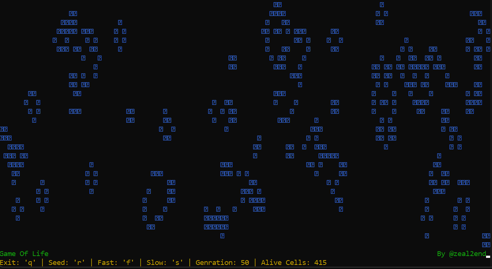

<!--Please do not remove this part-->


[](https://github.com/zeal2end)

# Conway's Game of Life

<p align="center">

</p>

## 🛠️ Description

A feature-rich terminal simulation of **Conway's Game of Life** — the famous cellular automaton devised by British mathematician John Horton Conway. 

The universe of the Game of Life is an infinite, two-dimensional orthogonal grid of square cells, each of which is in one of two possible states, live or dead. Every cell interacts with its eight neighbours following Conway's four rules:
1. **Underpopulation**: Any live cell with fewer than two live neighbours dies.
2. **Survival**: Any live cell with two or three live neighbours lives on to the next generation.
3. **Overpopulation**: Any live cell with more than three live neighbours dies.
4. **Reproduction**: Any dead cell with exactly three live neighbours becomes a live cell.

---

### ✨ Features
- **Responsive Curses UI**: Zero-latency, non-blocking keyboard controls with colors, generation counters, live cell statistics, and auto-resizing.
- **In-place Cell Drawing / Edit Mode**: Toggle with `e` to place or erase cells interactively using Arrow keys or `WASD` / `HJKL` and `Space`/`Enter`.
- **Interactive ANSI Terminal Fallback**: Cross-platform non-blocking interactive controls (Pause, Step, Clear, Randomize, Speed, Presets, Quit) for environments without `curses` (Windows, Linux, macOS).
- **Universal Pattern Support (RLE & Plaintext)**: Import standard community patterns via `--rle` string or `--file` (`.rle` and `.cells`), and export patterns using `--export`.
- **Automated Cycle & Stability Detection**: Real-time detection of **Extinction** (0 alive), **Still Life** (period 1), and **Oscillators** (period 2–16) displayed in the HUD status bar.
- **Expanded Pattern Preset Library**:
  1. `blinker` (Period 2 oscillator)
  2. `toad` (Period 2 oscillator)
  3. `beacon` (Period 2 oscillator)
  4. `glider` (Spaceship)
  5. `pulsar` (Period 3 oscillator)
  6. `gosper_gun` (Gosper Glider Gun)
  7. `lwss` (Lightweight Spaceship)
  8. `pentadecathlon` (Period 15 oscillator)
  9. `diehard` & `acorn` (Famous Methuselahs)
- **Extensive CLI Customization**: Configure grid size (`--rows`, `--cols`), random density (`--density`), speed (`--speed`), symbols (`--alive-char`, `--dead-char`), step limits (`--steps`), and boundary wrapping (`--no-wrap`).

---

## 🎮 Interactive Controls

### Simulation Mode (Curses & Terminal Fallback)
| Key | Action |
| :--- | :--- |
| `Space` / `p` | Pause / Resume simulation |
| `e` | Enter / Exit interactive **Cell Edit Mode** (Curses UI) |
| `n` | Single-step forward one generation |
| `r` | Randomize grid cells |
| `c` | Clear grid |
| `w` | Toggle Toroidal wrap-around boundaries |
| `1` – `9` | Load preset pattern directly |
| `f` / `+` | Increase speed (faster) |
| `s` / `-` | Decrease speed (slower) |
| `q` / `Esc` | Exit simulation |

### Interactive Edit Mode (`e`)
| Key | Action |
| :--- | :--- |
| `Arrow Keys` / `WASD` / `HJKL` | Move cursor around grid |
| `Space` / `Enter` | Toggle cell Alive / Dead at cursor position |
| `c` | Clear grid canvas |
| `r` | Seed random cells |
| `e` | Exit Edit Mode and resume simulation |

---

## ⚙️ Requirements & Installation

### Linux & macOS
Python standard library includes `curses` out of the box:
```sh
pip install -r requirements.txt
```

### Windows
On Windows, install `windows-curses` for the interactive full-screen curses UI:
```sh
pip install windows-curses
```
*(Note: If `windows-curses` is not installed, the script will automatically run in full interactive ANSI Terminal Mode with non-blocking keyboard controls!)*

---

## 🌟 How to Run

### 1. Interactive Full-Screen UI (Curses)
```sh
python GameOfLife.py
```
*Press `e` anytime to enter Edit Mode and draw custom patterns!*

### 2. Launch with a Specific Preset
```sh
python GameOfLife.py --preset pulsar
```

### 3. Load Community Patterns via RLE (Run Length Encoded)
```sh
python GameOfLife.py --cli --rle "3o$o$bo!"
```

### 4. Load Pattern from an External File
```sh
python GameOfLife.py --file patterns/glider.rle
```

### 5. Command-Line (ANSI Fallback) Mode with Custom Symbols
```sh
python GameOfLife.py --cli --preset lwss --speed 0.1 --alive-char "#" --dead-char "."
```

### 6. Automated Fixed-Step Run with RLE Export
```sh
python GameOfLife.py --cli --preset gosper_gun --steps 50 --export
```

---

## 📺 Demo
<p align="center">

</p>

---

## 🧪 Running Automated Tests

Run the complete 18-test unit test suite verifying simulation rules, oscillators (period 2, 3, 15), spaceships, cycle detection, RLE/Plaintext parsers, cell editing, and boundary wrapping:
```sh
python -m unittest test_game_of_life.py -v
```

---

## 🤖 Authors & Contributors
- **Original Author**: [Vivek Kumar](https://github.com/zeal2end)
- **Improvements & Fixes**: Open Source Contributors