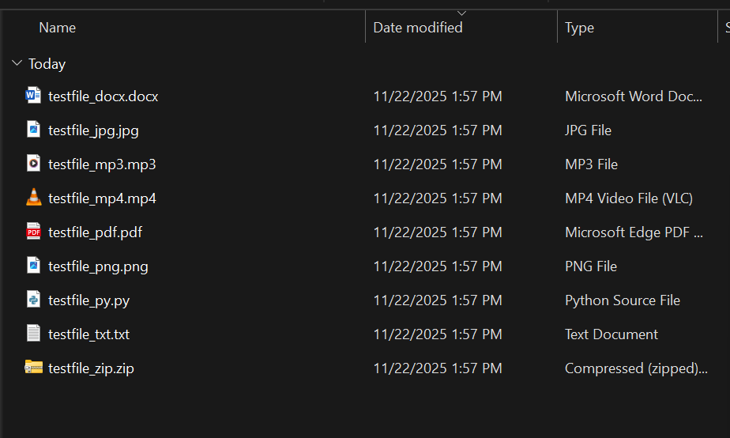
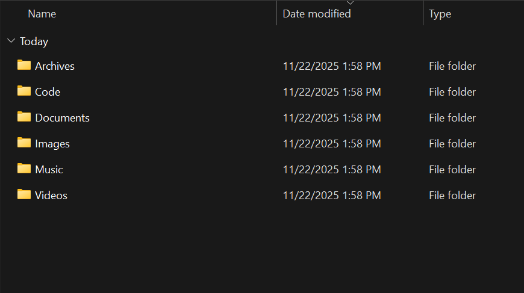
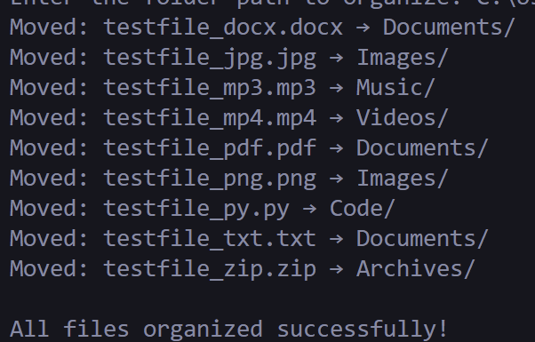

<!--Please do not remove this part-->


# File Organizer
<p align="center">


## 🛠️ Description

The **File Organizer** is a simple Python script that automatically sorts and organizes files in a selected folder based on their file types. The neat freak your computer needs.

It creates categorized subfolders (like **Documents**, **Images**, **Videos**, etc.) and moves files into the right place.  


You can,
1. Improve its functionality (e.g., add new categories, GUI, etc.)
2. Fix bugs or optimize the logic
3. Add a new cool feature like a config file

Every contribution counts — even small ones 💪

## ⚙️ Languages or Frameworks Used

This script only uses Python's **standard library** (`os`, `shutil`), so no additional dependencies are required.  

## 🌟 How to run

1. Clone the repository and navigate to the folder:
   ```bash
   git clone https://github.com/<your-username>/python-mini-project.git
   cd python-mini-project/file_organizer
```

2. Run the script:

   ```bash
   python main.py
   ```

   or, if that doesn’t work:

   ```bash
   python3 main.py
   ```

3. Enter the folder path you want to organize when prompted.

To stop it, press **CTRL + C**

## 📺 Demo

Some demos of the script in action:

<p align="">



</p>


## 🤖 Author

This script is by **Jaimz**.

Jaimz → [https://github.com/jaimzh](https://github.com/jaimzh)
This is my GitHub profile.


