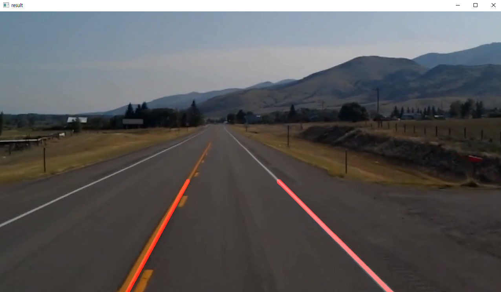

<!--Please do not remove this part-->


# 🚘 Finding Lanes

> Real-time and static road lane boundary detection and drivable corridor visualization using OpenCV and NumPy.

<p align="center">
  
</p>

## 🛠️ Description

**Finding Lanes** is a modular Python computer vision project that detects, smooths, and highlights road lane boundaries from static images, video files, or live camera feeds. 

The pipeline processes each frame through several computer vision stages:
1. **Grayscale Conversion & Gaussian Blur**: Reduces image noise and gradient variance.
2. **Canny Edge Detection**: Identifies sharp brightness transitions indicating potential lane boundaries.
3. **Region of Interest (ROI) Masking**: Dynamically computes an ROI polygon mask proportional to frame dimensions to eliminate irrelevant road surroundings and sky without corrupting multi-channel color data.
4. **Hough Transform Line Detection (`cv2.HoughLinesP`)**: Identifies line segments from edge pixels.
5. **Spatial Filtering & Slope-Intercept Regression**: Separates left and right lines using slope signs and spatial vehicle midpoint constraints, avoiding cross-lane contamination from shadows or opposite-side markings.
6. **Temporal Lane Tracking & Smoothing (`LaneTracker`)**: Applies an exponential moving average (EMA) filter across consecutive video frames to prevent jitter and maintain continuous lane estimates across brief dash dropouts.
7. **Alpha Blending & Drivable Corridor Fill (`cv2.addWeighted`)**: Overlays highlighted lane boundaries and optional drivable corridor polygons onto the original frame.

---

## ✨ Features

- **Dynamic ROI**: Adapts automatically to arbitrary image/video resolutions and aspect ratios; preserves 3-channel color data seamlessly.
- **Cross-Lane Spatial Filtering**: Rejects erroneous segments on the opposite side of the road to prevent lane crossing distortions.
- **Temporal Smoothing (`LaneTracker`)**: Eliminates frame-to-frame video jitter and retains lane stability through temporary line dropouts.
- **Drivable Corridor Fill (`--fill-lane`)**: Highlights the road lane corridor between left and right boundaries with a semi-transparent overlay.
- **Multi-Source Support**: Seamlessly processes static images (`picture.jpg`), video files (`video.mp4`), or live camera streams (`--camera 0`).
- **Dynamic Playback Timing**: Synchronizes GUI video playback to native video frame rates (FPS).
- **Headless & Batch Support**: `--no-show` flag and `--output` options with proper exit codes for automated and CI pipelines.
- **Pipeline Visualizer (`sub.py`)**: 4-panel subplot showing Original, Canny Edges, ROI Masked, and Lane Detection stages side-by-side.
- **Comprehensive Unit Tests (`test_lanes.py`)**: 22 automated tests covering all core functions, color preservation, EMA smoothing, and edge cases.

---

## ⚙️ Requirements & Installation

Ensure you have Python 3.8+ installed. Install the required dependencies:

```sh
pip install -r requirements.txt
```

Or install dependencies manually:

```sh
pip install opencv-python numpy matplotlib
```

---

## 🌟 How to Run

Navigate to the project folder:

```sh
cd Finding_Lanes
```

### 1. Run Lane Detection on Video (Default)
```sh
python lanes.py
```
> Press **`q`** on the video window to quit.

### 2. Run with Drivable Lane Corridor Highlighted
```sh
python lanes.py --image picture.jpg --fill-lane
```

### 3. Run on a Static Image
```sh
python lanes.py --image picture.jpg
```

### 4. Run on Custom Video and Save Output
```sh
python lanes.py --video path/to/video.mp4 --output output.mp4 --fill-lane
```

### 5. Run on Live Webcam
```sh
python lanes.py --camera 0
```

### 6. Multi-Stage Pipeline Visualizer (`sub.py`)
To inspect intermediate computer vision stages side-by-side using Matplotlib:
```sh
python sub.py
```
Or with drivable corridor fill and save to file:
```sh
python sub.py --image picture.jpg --output pipeline_stages.png --fill-lane
```

---

## 🧪 Running Unit Tests

Run the test suite using Python's built-in `unittest` runner:

```sh
python -m unittest test_lanes.py -v
```

---

## 📂 Project Structure

```
Finding_Lanes/
├── README.md          # Project documentation and guide
├── ISSUE.md           # Issue report template and bug documentation
├── PULL_REQUEST.md    # Pull request summary and contribution details
├── requirements.txt   # Project dependencies specification
├── lanes.py           # Core lane detection engine, LaneTracker, and CLI
├── sub.py             # 4-stage pipeline visualization utility
├── test_lanes.py      # Automated unit test suite (22 test cases)
├── picture.jpg        # Sample input road image
├── video.mp4          # Sample input road driving video
└── capture.png        # Demo output screenshot
```

---

## 📺 Demo

<p align="center">
  
</p>

---

## 🤖 Author

- Original Script: **zmdlw** ([@zmdlw](https://github.com/zmdlw))
- Enhancements & Tests: **Prayas Dey** ([@Prayas340](https://github.com/Prayas340))
