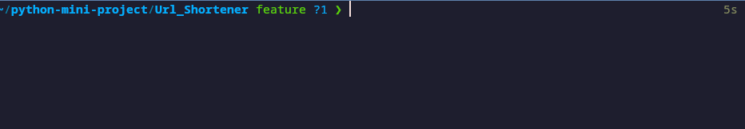

<!--Please do not remove this part-->


  

# URL Shortener

  


  

## 🛠️ Description

A CLI URL shortener using the Bitly API. Now available in two versions:
- **Original** (`url_shortner.py`) - Simple and straightforward
- **Enhanced** (`url_shortener_enhanced.py`) - With validation, config file, and better error handling

  

## ⚙️ Languages or Frameworks Used

Python 3.x with the following dependencies:

```bash
pip install -r requirements.txt
```

## 🌟 How to Run

### Option 1: Original Version

1. Open `url_shortner.py`
2. Replace the `api_key` variable with your Bitly API key
3. Run: `python url_shortner.py`

### Option 2: Enhanced Version (Recommended)

1. Get your Bitly API key from https://bitly.com/a/settings/api
2. Create config file:
   ```bash
   cp config.example.json config.json
   ```
3. Edit `config.json` and add your API key
4. Run: `python url_shortener_enhanced.py`

## ✨ Enhanced Version Features

- ✅ **URL Validation** - Validates URLs before shortening to prevent errors
- ⚙️ **Config File** - Secure API key storage (not hardcoded)
- 🛡️ **Better Error Handling** - Clear error messages with retry logic
- 🔄 **Auto-fix URLs** - Automatically adds `https://` if missing
- 📊 **Enhanced UI** - Clean output with helpful messages
- 🔒 **Security** - Config file is gitignored to protect your API key

### Valid URL Examples
- `https://www.google.com` ✅
- `google.com` ✅ (auto-adds https://)
- `http://example.com/long/path?query=value` ✅

### Invalid URLs (Caught by Validation)
- Empty input ❌
- `not a url` ❌
- `ftp://example.com` ❌ (wrong protocol)
- `https://` ❌ (no domain)

## 📺 Demo



## 🤖 Authors

- Original: [dongjin2008](https://github.com/dongjin2008)
- Enhanced version: [Your GitHub Username]
